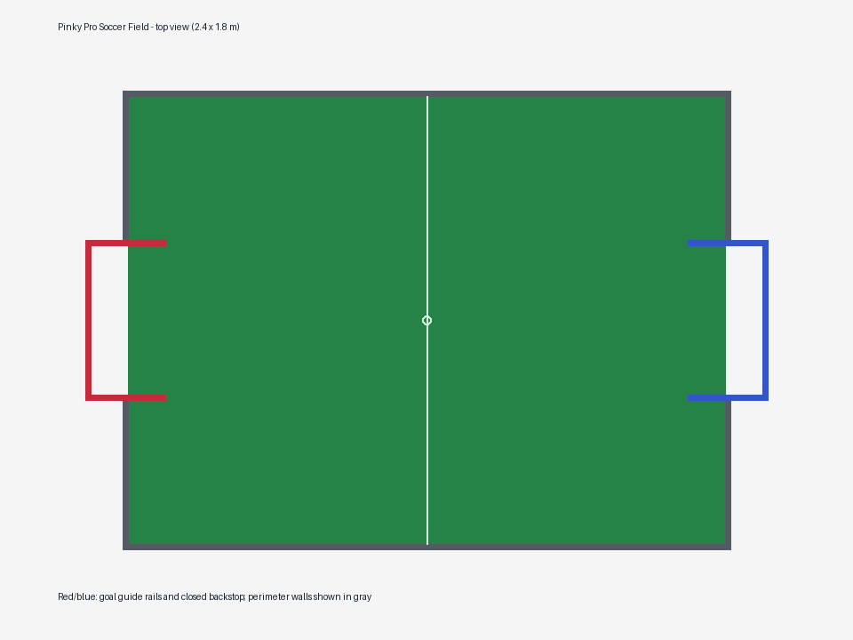

# 핑키프로 1:1 축구 — ROS 2 Jazzy · MuJoCo 시뮬 · 실물 2대

핑키프로(Pinky Pro) 로봇 두 대가 주황 골프공으로 1:1 축구를 합니다. 공식 [`pinklab-art/pinky_pro`](https://github.com/pinklab-art/pinky_pro)의 로봇 모델·센서·Nav2 구성을 그대로 쓰고, 그 위에 경기장, 공 인식, 공격 전략, 심판, 경기 창, 보정 도구를 얹었습니다.

- **시뮬레이션 (MuJoCo):** 실물과 같은 구성으로 두 로봇이 자동 경기를 합니다. 골 세레모니, 팀 색 LED, 앞 화면 국기도 나옵니다.
- **실물 2대:** PC 한 대가 두 로봇의 위치 추정·공 인식·판단을 맡고, 로봇은 센서와 바퀴만 담당합니다.
- **보정 창:** 공 색, 카메라 렌즈(체커보드), 카메라 각도, 바퀴 반지름을 한 창에서 보정하고 파일로 저장합니다.

| | |
|---|---|
| 환경 | Ubuntu 24.04 · ROS 2 **Jazzy** · MuJoCo 3.6 (Gazebo Harmonic도 지원) · CycloneDDS |
| 로봇 | 공식 `pinky_description` (RPLIDAR C1, 카메라, IMU, 차동구동 휠 Ø54 mm / 간격 96.1 mm) + 앞 범퍼 |
| 공 / 경기장 | 골프공 Ø42.7 mm · 4판 훈련 경기장 1.66 × 1.06 m (`field_style:=rcj`로 RoboCupJunior 규격) |

---

## 1. 전체 구성

로봇 두 대는 각자 **다른 ROS 도메인**(노랑 37, 파랑 38)에서 돌고, PC 한 대가 두 로봇의 "머리" 역할을 같이 합니다. 두 로봇이 똑같은 토픽 이름(`/cmd_vel`, `/scan` …)을 써도 섞이지 않게 도메인을 나누고, 경기 정보만 `domain_relay`가 옮깁니다.

```
 ┌──────── 노랑 로봇 (도메인 37) ─────────┐      ┌──────── 파랑 로봇 (도메인 38) ─────────┐
 │ 모터·바퀴 엔코더 / 라이다 / 카메라 / IMU │      │              (같은 구성)                │
 │ LED·LCD 화면·부저 (pinky_display.py)    │      │                                          │
 └────────────────▲───────────────────────┘      └────────────────▲─────────────────────────┘
                  │ Wi-Fi (CycloneDDS, 유니캐스트)                  │
 ┌────────────────┴───────────────────────── PC ──────────────────┴─────────────────────────┐
 │ [노랑용, 도메인 37]                                    [파랑용, 도메인 38]                 │
 │  AMCL 위치 추정 + Nav2 · ball_detector · striker       (같은 세 가지)                     │
 │                                                                                            │
 │  real_referee(심판) · match_ui(경기 창) · sensor_view(센서 창)  ⇄  domain_relay (37 ↔ 38)  │
 └────────────────────────────────────────────────────────────────────────────────────────────┘
```

한 로봇이 움직이는 흐름:

```
카메라 ──► ball_detector ──► 공 위치(맵 좌표) ──┐
라이다 ──► AMCL(경기장 맵과 비교) ──► 내 위치 ──┤
바퀴·IMU ──► /odom ──► AMCL ────────────────────┤
                                                ▼
                     striker: 찾기 → 공 뒤로 돌아가기 → 몰기 → 슛 (+ 상대 피하기, 세레모니)
                                                │
                                                ▼
                     Nav2 (경로·속도) ──► /cmd_vel ──► 로봇 바퀴
```

| 역할 | 파일 |
|---|---|
| 공 검출: 주황색(HSV) → 카메라 각도·렌즈 값으로 바닥 위치 → 맵 좌표 | [`ball_detector.py`](src/pinky_soccer_vision/pinky_soccer_vision/ball_detector.py) |
| 공격수 판단 (상태 기계) | [`striker.py`](src/pinky_soccer_game/pinky_soccer_game/striker.py) |
| 위치 추정·주행 설정 (AMCL, Nav2) | [`nav.launch.py`](src/pinky_soccer_nav/launch/nav.launch.py) |
| 심판: 골·코너 판정, 점수 (실물 / 시뮬) | [`real_referee.py`](src/pinky_soccer_game/pinky_soccer_game/real_referee.py), [`referee.py`](src/pinky_soccer_game/pinky_soccer_game/referee.py) |
| 경기 창 / 센서 창 | [`match_ui.py`](src/pinky_soccer_game/pinky_soccer_game/match_ui.py), [`sensor_view.py`](src/pinky_soccer_game/pinky_soccer_game/sensor_view.py) |
| 도메인 37 ↔ 38 중계 | [`domain_relay.py`](src/pinky_soccer_game/pinky_soccer_game/domain_relay.py) |
| MuJoCo 시뮬레이터 | [`mujoco_soccer.py`](src/pinky_soccer_sim/pinky_soccer_sim/mujoco_soccer.py) |
| 보정 창 | [`camera_calib_ui.py`](src/pinky_soccer_vision/pinky_soccer_vision/camera_calib_ui.py) |
| 로봇 LED·LCD·소리 (로봇에서 실행) | [`pinky_display.py`](src/pinky_soccer_vision/robot/pinky_display.py) |
| 실행 묶음 (시뮬 / 실물) | [`sim_duel.launch.py`](src/pinky_soccer_bringup/launch/sim_duel.launch.py), [`real_duel.launch.py`](src/pinky_soccer_bringup/launch/real_duel.launch.py) |

더 자세한 설명과 공부 순서: [docs/ARCHITECTURE.md](docs/ARCHITECTURE.md)

### 폴더 구성
```
src/
  pinky_pro/                  공식 레포 (setup 스크립트가 받아 옴, 저장소에는 없음)
  pinky_soccer_description    공식 모델 래퍼 + 앞 범퍼
  pinky_soccer_sim            경기장·맵 생성, MuJoCo 시뮬(mujoco_soccer), Gazebo 런치, 화면 그림(media/)
  pinky_soccer_nav            경기장용 Nav2/AMCL/SLAM 설정과 런치
  pinky_soccer_vision         공 검출, 보정 창, YOLO 학습, 로봇용 프로그램(robot/)
  pinky_soccer_game           striker · referee · real_referee · match_ui · sensor_view · domain_relay
  pinky_soccer_bringup        실행 묶음: sim_duel / real_duel / stage1~6
scripts/                      설치, 보정 창 실행, 점검 스크립트
scripts/robot/                로봇에 복사해서 쓰는 시작·정지 스크립트
config/                       CycloneDDS 설정 예시 (PC / 로봇)
docs/                         구성 설명
```

### 경기 규칙
- 선공은 없습니다. 경기 시작과 골 뒤 재시작 모두 공을 **센터**에 두고 출발합니다. 골 뒤 재시작에서는 **직전에 골을 넣은 로봇이 3초 늦게** 출발합니다(`scorer_delay`).
- 시작 위치: 자기 골대 앞 흰 페널티 라인 바로 앞(로봇 뒷면이 라인에 닿게), 상대 골대를 바라봄.
- 골: 넣은 로봇이 자기 진영 가운데로 가서 **제자리 3바퀴** 세레모니를 하고 시작 위치로 돌아갑니다. 앞 화면은 국기에서 골 사진으로 바뀌고, 실물은 LED가 깜빡이며 골 소리가 납니다.
- 실점한 로봇은 자기 골대 앞에 서 있지 않고, 먼저 **중앙선 근처(자기 진영, 상대 반대쪽)** 로 비켰다가 1.5초 뒤 시작 위치로 돌아갑니다(`concede_centre`). 세레모니하러 돌아가는 상대와 부딪히지 않게 하기 위해서입니다.
- 자동 시작: 두 로봇이 READY이고 공이 센터 12 cm 안에서 2초 동안 가만히 있으면 시작합니다. 기다리는 이유는 경기 창에 `자동 시작 대기: …`로 나옵니다.
- 골 판정: 오탐을 막기 위해 0.6초 안에 공이 골 안에서 4번 이상 보여야 골로 인정합니다.
- **라인 가드:** 로봇은 흰 바깥 라인을 넘어가지 않습니다. 카메라로 흰 라인을 찾아 바닥 위치로 바꾸고, 지도와 비교해 바깥 라인만 골라냅니다. 중앙선·페널티 라인은 지나갈 수 있고, 골문 앞 골라인은 제외해서 골은 그대로 넣을 수 있습니다. 바로 앞 바닥은 카메라에 안 보여서, 본 라인을 4초 동안 기억합니다(`line/boundary`). 그 라인 쪽으로 가는 직진·후진은 막고, 회전은 허용합니다.
- 공 재배치: 랜덤 위치는 쓰지 않습니다. 다음 경우에만 공을 센터로 옮기고, 로봇은 그대로 경기합니다.
  - 공이 골대 옆으로 골라인을 넘어 나감
  - 공이 바깥 라인에서 6 cm 안쪽(또는 바깥)에 붙어 10초 동안 안 움직임: 로봇이 라인을 넘을 수 없어 아무도 칠 수 없는 공입니다.
  - 공이 모서리에 끼어 5초 동안 안 움직임
- 상대 로봇은 장애물로 보고 감속하며 옆으로 돌아갑니다(`avoid_opponent:=false`면 몸싸움 허용).
- 공이 한 바퀴 돌아도 안 보이면 경기장 가운데와 네 구역 중심을 돌아다니며 찾습니다.
- 먼저 **5점**(`win_score`)을 내면 끝납니다.

---

## 2. 빠른 시작 — 시뮬레이션 (MuJoCo)

설치(4장)를 마친 뒤:

```bash
pip install --user --break-system-packages "mujoco==3.6.0" "trimesh>=4,<5" "pycollada>=0.9,<1" "numpy==1.26.4"   # 처음 1회
colcon build --packages-select pinky_gz_sim pinky_mujoco                                                       # 처음 1회
ros2 launch pinky_soccer_bringup sim_duel.launch.py
```

- MuJoCo 화면, 경기 창, 센서 창이 뜹니다. 경기 창에서 **경기 시작**을 누르세요.
- 노랑은 도메인 37·토픽 `/yellow/…`, 파랑은 도메인 38·토픽 `/blue/…`를 씁니다. 예: `ROS_DOMAIN_ID=38 ros2 topic echo /blue/game/state`
- 옵션: `avoid_opponent:=false`(몸싸움 허용), `ball_roll:=0.0003`(공 구름 저항), `win_score:=3`, `headless:=true`, `sim:=gz`(같은 구성을 Gazebo로)
- ⚠️ 실물 로봇을 켜 둔 동안에는 시뮬을 켜지 마세요. 시뮬도 37/38번 도메인을 씁니다.

---

## 3. 실물 2대 경기

### 3-1. 처음 1회 준비

**로봇 (두 대 모두)**
1. 로봇 드라이버는 이 저장소가 아니라 [`cse1598/pinky-soccer`](https://github.com/cse1598/pinky-soccer)(main)의 로봇용 패키지를 씁니다. `robot.launch.py`가 바퀴·라이다·카메라(JPEG)·IMU·TF와 `/cmd_vel` 감시(watchdog)를 켭니다. 로봇에 공식 `pinky_pro`(`~/pinky_pro`)와 그 저장소(`~/pinky_soccer_ws`)를 받아 빌드합니다. 패키지 이름이 이 저장소와 겹치므로 **로봇에는 이 저장소를 빌드하지 마세요.**
2. [`config/cyclonedds_robot.xml.example`](config/cyclonedds_robot.xml.example)을 `~/cyclonedds.xml`로 복사하고 `PC_IP`를 PC 주소로 바꿉니다. 공용 와이파이는 멀티캐스트를 막는 경우가 많아서 PC를 직접 적어 줍니다.
3. [`scripts/robot/`](scripts/robot/)의 `start_robot.sh`, `start_display.sh`, `stop_soccer.sh`를 로봇 홈(`~/`)에 복사하고, 맨 위 `TEAM`과 `WHEEL_RADIUS`를 로봇에 맞게 고칩니다.
4. (선택) 화면·소리: `src/pinky_soccer_vision/robot/pinky_display.py`를 `~/`에, 그림을 `~/soccer_media/`에 복사합니다(6장 참고).

**PC**
- [`config/cyclonedds_pc.xml.example`](config/cyclonedds_pc.xml.example)을 `~/cyclonedds_pc.xml`로 복사하고, 와이파이 인터페이스 이름과 두 로봇 주소를 넣습니다.

| 팀 | ROS_DOMAIN_ID | 공격 방향 | 시작 위치 |
|---|---|---|---|
| 노랑 | 37 | +X | −X 쪽 페널티 라인 바로 앞 |
| 파랑 | 38 | −X | +X 쪽 페널티 라인 바로 앞 |

### 3-2. 매번 하는 순서
1. PC와 두 로봇을 같은 와이파이에 연결합니다. 로봇 주소는 로봇 LCD에 나옵니다.
2. 두 로봇에서 각각 드라이버를 켭니다.
   ```bash
   ssh pinky@<로봇 IP>
   ~/start_robot.sh          # 끄기: ~/stop_soccer.sh
   ~/start_display.sh &      # (선택) 팀 색 LED, 국기 화면, 골 소리
   ```
3. 연결 확인(선택):
   ```bash
   export RMW_IMPLEMENTATION=rmw_cyclonedds_cpp CYCLONEDDS_URI=file://$HOME/cyclonedds_pc.xml
   ROS_DOMAIN_ID=37 ros2 topic echo /odom --once      # 노랑
   ROS_DOMAIN_ID=38 ros2 topic echo /odom --once      # 파랑
   ```
4. 로봇을 시작 위치에, 공을 센터에 둡니다.
5. **로봇 두 대를 먼저 켠 다음에** PC에서 실행합니다. 로봇이 꺼진 상태로 띄우면 그 로봇의 Nav2가 비활성으로 남습니다.
   ```bash
   ros2 launch pinky_soccer_bringup real_duel.launch.py
   ```
6. 경기 창에서 **경기 시작**을 누르면 두 로봇이 시작 위치로 정렬하고, 센터 공이 2초 동안 가만히 있으면 시작합니다. **바로 시작**은 지금 자리에서 시작, **정지**는 두 로봇을 멈춥니다.

---

## 4. 설치 (처음 1회)

### 방법 A — 스크립트 한 번에
```bash
git clone https://github.com/ddoyo88/pinky_soccer_ws.git ~/pinky_soccer_ws
cd ~/pinky_soccer_ws
./scripts/setup_workspace.sh            # apt 설치 + 공식 pinky_pro clone + 빌드 (10~20분)
```

### 방법 B — 수동
```bash
# 1) 패키지
sudo apt update
sudo apt install -y git python3-colcon-common-extensions python3-rosdep python3-opencv python3-numpy python3-yaml \
  ros-jazzy-ros-gz ros-jazzy-navigation2 ros-jazzy-nav2-bringup ros-jazzy-slam-toolbox \
  ros-jazzy-xacro ros-jazzy-robot-state-publisher ros-jazzy-joint-state-publisher \
  ros-jazzy-joint-state-publisher-gui ros-jazzy-rviz2 ros-jazzy-teleop-twist-keyboard ros-jazzy-rqt-image-view

# 2) 공식 핑키 레포를 src 안에 받기 (이 워크스페이스는 b1600c3 기준으로 확인)
cd ~/pinky_soccer_ws/src
git clone https://github.com/pinklab-art/pinky_pro.git
git -C pinky_pro checkout b1600c30b49b572fefed7dcad57527948da88b45

# 3) 빌드 (필요한 패키지만)
cd ~/pinky_soccer_ws
source /opt/ros/jazzy/setup.bash
colcon build --symlink-install --packages-up-to pinky_soccer_bringup
```

### 새 터미널을 열 때마다
```bash
source /opt/ros/jazzy/setup.bash
source ~/pinky_soccer_ws/install/setup.bash
```
> 터미널 여러 개가 필요합니다 (시뮬레이션 1개 + 키보드/확인용 1~2개). 아래 "터미널 A/B"로 표기합니다.

### (선택) YOLO 학습용
```bash
pip install ultralytics --break-system-packages
```

### 공식 레포에서 가져다 쓰는 것
| 공식 패키지 | 어떻게 쓰나 |
|---|---|
| `pinky_description` | URDF/메시/센서/DiffDrive 플러그인을 **수정 없이** 그대로 사용. `pinky_soccer_description`은 `insert_robot` 매크로를 불러오며, 앞쪽 V자 가드는 기본적으로 끔 |
| `pinky_navigation` | Nav2/AMCL 런치(`gz_bringup_launch.xml`), SLAM 런치(`gz_map_building.launch.xml`), RViz 설정을 **그대로 include**. 파라미터 파일만 경기장 크기에 맞게 바꿔 끼움 |
| `pinky_gz_sim` | 브리지 설정(`pinky_bridge.yaml`)을 그대로 복사해 사용 → 토픽 이름이 **실물 핑키와 동일** (`/cmd_vel /odom /tf /scan /camera/...`). 패키지 자체는 `gz_ros2_control`이 필요해서 빌드하지 않음 |
| `pinky_bringup`, `pinky_mujoco` 등 | 사용 안 함 (실물 구동 / MuJoCo용) |

공식 레포는 `scripts/setup_workspace.sh`가 `src/pinky_pro`로 받아 옵니다 (검증한 커밋 `b1600c3`에 고정).

---

## 5. 보정 (실물 로봇마다)

로봇마다 카메라 장착 각도와 렌즈, 바퀴가 조금씩 다릅니다. 보정 창 하나로 모두 보정합니다. 로봇 드라이버(`start_robot.sh`)를 켠 상태에서:

```bash
./scripts/camera_calib.sh blue        # 노랑: ./scripts/camera_calib.sh yellow
```

| 순서 | 할 일 | 왜 필요한가 |
|---|---|---|
| 1. 공 색 (HSV) | 슬라이더로 주황 범위 조정, "마스크 보기"로 공만 흰색인지 확인 | 조명에 따라 주황 범위가 달라짐 |
| 4. 렌즈 (체커보드) | 안쪽 코너 수(예: 칸 9×6 보드 → 8×5)와 칸 크기(m) 입력 → **수집 시작** → 보드를 화면 네 귀퉁이·가까이·멀리·기울여서 15~20장 → **계산** (오차 0.5 px 이하 좋음, 1 px 이하 사용 가능) | 렌즈가 화면 가장자리를 휘게 해서 옆 거리가 틀어짐 |
| 2. 카메라 각도 | 공을 로봇 정면, 바퀴 축 중심에서 잰 거리(예: 0.50 m)에 두고 거리 입력 → **측정·계산** | 각도가 1°만 틀려도 먼 공의 거리가 크게 틀림 (가짜 골의 원인) |
| 5. 바퀴 | 바퀴 축 중심 아래 바닥에 테이프 표시 → **1 m 전진** → 실제 이동 거리 입력 → **반지름 계산**. **1바퀴 회전**은 IMU로 잰 각도로 바퀴 간격 계산 | 1 m 명령에 다르게 가면 위치 추정이 밀림 |
| 3. 저장 | `~/.config/pinky_soccer/camera_<팀>.yaml` | |

- 체커보드는 **안쪽 코너**(네 칸이 만나는 점)만 검출합니다. 보드 테두리 바깥 코너가 안 잡히는 것은 정상입니다.
- 카메라 화면 위쪽에 `front / side / dist`로 공 위치가 나옵니다. 줄자로 잰 값과 비교해서 0.6 m에서 ±3 cm, 1.0 m에서 ±5 cm 안이면 합격입니다.
- **카메라 값**(HSV, 각도, 렌즈)은 `real_duel`이 시작할 때 yaml에서 읽어 공 검출에 넣습니다. 터미널에 `[real_duel] <팀> camera calibration from ...`이 나오면 적용된 것입니다.
- **바퀴 값**은 로봇의 모터 드라이버가 쓰므로 yaml은 기록용입니다. 로봇의 `~/start_robot.sh`에서 `WHEEL_RADIUS` / `WHEEL_SEPARATION`을 고치고 드라이버를 다시 켜야 적용됩니다.
- 다른 PC에서 보정한 파일도 같은 이름(`camera_yellow.yaml` / `camera_blue.yaml`)으로 `~/.config/pinky_soccer/`에 넣으면 됩니다.

---

## 6. 로봇 화면 · LED · 소리

| 팀 | LED | 평소 화면 | 골 세레모니 화면 |
|---|---|---|---|
| 노랑 | 노란색 | 포르투갈 국기 (`portugal.png`) | `ronaldo.png` |
| 파랑 | 파란색 | 태극기 (`taegukgi.png`) | `son.png` |

- 그림은 [`src/pinky_soccer_sim/media/`](src/pinky_soccer_sim/media/)에 있습니다(400×300, 4:3). 시뮬은 여기서, 실물은 로봇의 `~/soccer_media/`에서 읽습니다.
- **골 사진(`son.png`, `ronaldo.png`)은 저작권 때문에 저장소에 넣지 않았습니다.** 원하는 사진을 같은 이름으로 넣으면 됩니다. 없으면 세레모니 중에도 국기가 나옵니다.
- 실물: [`pinky_display.py`](src/pinky_soccer_vision/robot/pinky_display.py)가 LED(pinkylib), 앞 LCD(240×320, `pinky_emotion.pinky_lcd`), 부저를 씁니다. 자기 팀이 골을 넣으면 사진·LED 깜빡임·멜로디, 코너 재배치와 경기 종료에도 소리가 납니다. `led_server`·`emotion_server`와 동시에 켜지 마세요.

---

## 부록 A. 단계별 실행 (Gazebo, 한 로봇)

처음 개발할 때 쓰던 단계별 구성입니다. 경기장 치수 설명 중 일부는 예전 경기장 기준입니다.

### 좌표계
원점 = 경기장 중심, **X = 2.4 m(길이)**, Y = 1.8 m(폭). 골대는 1.8 m 면(X 양 끝) 중앙.

```
                 y
                 ▲
     ┌───────────┼────────────────────────┐
     │  red      │                  blue  │
   ├─┤ 골대      │              골대 ├─┤   ← 골 입구 폭 0.6 m, 안쪽 가이드와 뒤쪽 막이
     │    R →    │   ●(공)       ← B      │
     └───────────┼────────────────────────┘
               (0,0) ──────────▶ x
```


- **yellow (우리 로봇, `pinky_yellow`, 노란 LED)**: -X 노란 골대를 지키고 +X(파란) 골대로 공격, 시작 위치 (-L/4, 0) = (-0.6, 0)
- **blue (상대, `pinky_blue`, 파란 LED)**: -X(노란) 골대로 공격 / +X 파란 골대 수비, 시작 위치 (+L/4, 0)
- 경기장 둘레는 2 cm 두께의 연속된 벽으로 막습니다. 골문은 끝벽에 폭 0.6 m로 열리고, 양옆 가이드 벽이 안쪽/뒤쪽으로 이어져 골대 뒤를 막습니다.
- 벽 높이 0.18 m — 핑키 라이다 높이(0.125 m)보다 높고, 공(Ø4.3 cm)은 라이다보다 낮아 **공은 장애물로 안 잡힙니다**

각 단계는 **앞 단계가 되는지 확인하고 넘어가세요.** 시뮬레이션이 떠 있는 동안 `./scripts/check_sim.sh`로 토픽·TF·Nav2 상태를 한 번에 점검할 수 있습니다.

### 1단계 — 로봇 모델 확인 (시뮬레이터 없음)
```bash
ros2 launch pinky_soccer_bringup stage1_robot.launch.py
```
- RViz에 기본 핑키 모델이 보이고, 슬라이더 창에서 바퀴를 돌려볼 수 있습니다.
- 앞쪽 V자 가드가 필요하면 `dribbler:=true`로 켤 수 있습니다.

### 2단계 — 경기장 + 공 + 로봇
```bash
# 터미널 A
ros2 launch pinky_soccer_bringup stage2_field.launch.py
# 터미널 B
ros2 run teleop_twist_keyboard teleop_twist_keyboard      # z 키로 속도를 낮추세요 (기본 0.5 m/s는 빠름)
```
- Gazebo 창에 초록 바닥, 벽, 양쪽 골대(빨강/파랑), 주황 골프공, 빨간 핑키가 나타납니다. RViz에는 라이다 점과 카메라 영상이 보입니다.
- 확인: `ros2 topic hz /scan`(≈10 Hz), `ros2 topic hz /camera/image_raw`(≈30 Hz), `ros2 topic echo /odom --once`
- 로봇 앞면으로 공을 밀어 보세요 (공이 계속 굴러가면 7번 문제 해결 참고).
- 공 순간이동: `gz service -s /world/soccer/set_pose --reqtype gz.msgs.Pose --reptype gz.msgs.Boolean --timeout 2000 --req 'name: "golf_ball" position {x: 0.3 y: 0.2 z: 0.03}'`
- 상대 로봇 몸체 추가: `with_blue:=true` / GUI 없이: `headless:=true`

### 3단계 — SLAM으로 경기장 스캔
```bash
# 터미널 A  (상대 없이 스캔)
ros2 launch pinky_soccer_bringup stage3_slam.launch.py
# 터미널 B
ros2 run teleop_twist_keyboard teleop_twist_keyboard      # z를 7~10번 눌러 느리게, 경기장을 한 바퀴
# 터미널 C : 맵 저장
mkdir -p ~/maps && ros2 run nav2_map_server map_saver_cli -f ~/maps/scanned_field
```
- RViz(공식 map building 화면)에서 사각형 경기장과 **양쪽 골대 입구(빈 홈)** 가 보이면 성공.
- 저장한 맵의 **원점 = 스캔을 시작한 로봇 위치**입니다. 기본 시작점(-0.6, 0)에서 스캔하세요.
- 4~6단계는 이 단계를 건너뛰어도 됩니다 — 이상적인 경기장 지도가 자동 생성되어 쓰입니다.

### 4단계 — Nav2 주행 + 상대 회피
```bash
ros2 launch pinky_soccer_bringup stage4_nav.launch.py                                   # 자동 생성 지도 사용
ros2 launch pinky_soccer_bringup stage4_nav.launch.py map:=$HOME/maps/scanned_field.yaml # 스캔한 지도 사용
```
- RViz(공식 Nav2 화면)에서 **2D Goal Pose**를 클릭 → 핑키가 이동. 파란 핑키가 `patrol`로 왕복하며 움직이는 장애물 역할을 합니다 (`blue_mode:=idle|keeper|chaser|patrol`).
- 안 움직이면: `./scripts/check_sim.sh`의 Nav2 lifecycle 항목이 모두 `active`인지 확인. AMCL 위치가 틀리면 RViz **2D Pose Estimate**로 맞춰 주세요.

### 5단계 — 공 인식 (HSV → YOLO)
```bash
ros2 launch pinky_soccer_bringup stage5_vision.launch.py          # 기본 backend:=hsv (학습 없이 바로 동작)
ros2 run rqt_image_view rqt_image_view /ball/detection_image      # 파란 박스 = 검출
ros2 topic echo /ball/position_map                                # 맵 좌표계의 공 위치
```
**YOLO 학습** (시뮬이 켜진 상태에서, 라벨링은 자동):
```bash
ros2 run pinky_soccer_vision collect_dataset --out ~/datasets/golfball --num 1500   # 로봇/공/상대를 순간이동시키며 정답 bbox 자동 생성 (~30분)
ros2 run pinky_soccer_vision train_yolo --data ~/datasets/golfball/data.yaml --epochs 60
ros2 launch pinky_soccer_bringup stage5_vision.launch.py backend:=yolo model_path:=$HOME/pinky_soccer_runs/ball.pt
```
- 공 위치는 박스 중심 픽셀 광선과 "공 중심 높이 평면"의 교점으로 계산합니다 (깊이 카메라 불필요).
- `backend:=gt` = Gazebo 정답 좌표 (인식 없이 주행/전략만 따로 디버그할 때).

### 6단계 — 1:1 경기
```bash
ros2 launch pinky_soccer_bringup stage6_game.launch.py                  # 경기 UI + HSV 인식 + 골키퍼 상대
ros2 launch pinky_soccer_bringup stage6_game.launch.py backend:=gt      # 전략만 먼저 디버그
ros2 launch pinky_soccer_bringup stage6_game.launch.py backend:=yolo model_path:=$HOME/pinky_soccer_runs/ball.pt
```
- 경기 진행은 심판 노드가 자동으로 합니다.
  1. 경기 창에서 **경기 시작**을 누르면 두 로봇이 출발 위치로 갑니다. 둘 다 도착하면 공이 놓이고(첫 킥오프: 노랑 앞 5 cm) 1.5초 뒤 시작합니다.
  2. 골이 감지되면 바로 득점이 올라갑니다. 2초 뒤 두 로봇이 출발 위치로 돌아가고, 공은 중앙에 놓입니다. 실점한 팀이 먼저 터치하며 경기가 다시 시작됩니다.
  3. **5점**을 먼저 내면 경기가 끝나고 로봇이 멈춥니다. 목표 점수는 `win_score:=3`처럼 바꿀 수 있고, `0`이면 끝없이 진행합니다. 끝난 뒤 버튼이 **새 경기**(0:0)로 바뀝니다.
  - 40초 안에 출발 위치에 도착하지 못하면 그대로 킥오프합니다.
- 문제가 생겼을 때 쓰는 버튼:
  - **원위치**: 로봇을 출발 위치로 돌리고 직전 킥오프부터 다시 합니다(점수 유지).
  - **직전 골 취소**: 잘못 감지된 골을 1점 되돌리고, 그 골 전의 킥오프부터 다시 합니다.
- UI 없이 제어하려면 `/game/control`에 `NEW_GAME`, `RESET`, `UNDO_GOAL`, `STOP`을 보냅니다. 예: `ros2 topic pub --once /game/control std_msgs/String "data: RESET"`
- 볼 수 있는 토픽: 진행 단계 `/game/phase` (WAIT/PREPARE/START/GOAL/FINISHED), 점수 `/game/score`, 이벤트 `/game/event`, 노랑 상태 `/game/state`
- 동작: `SEARCH`(공 안 보임: 제자리 회전) → `APPROACH`(Nav2로 공 *뒤쪽*, 골 방향 자세로 이동) → `DRIBBLE`(로봇 앞면으로 공을 밀어 조준점으로 이동) → `SHOOT`(골 근처에서 정렬되면 0.7초 전속 돌진)
- **최종 목적지 좌표**: 기본 = 상대 골 중앙 `(L/2, 0)`. RViz의 **Publish Point**로 아무 곳이나 클릭하면 즉시 목표가 바뀝니다. 상대 키퍼가 골 앞에 있으면 반대쪽 모서리를 조준합니다.
- 상대 회피: 라이다 점 중 **저장된 지도 벽으로 설명되지 않는 점 = 상대**로 보고 반발(드리블 중) / Nav2 코스트맵(접근 중).
- 충돌 방지 (`pinky_soccer_game/avoidance.py`, 노랑·파랑 공통):
  - 경기 중: 진행 방향 앞 0.42 m 안에 상대가 있으면 감속하고 비켜 돌며, 0.18 m에서 정지합니다. 공이 내 앞에 붙어 있고 상대가 바로 그 공 너머에 있을 때만 0.12 m/s로 천천히 공을 다툽니다. 공 뒤로 가는 길을 상대가 막고 있으면 옆으로 돌아갑니다.
  - 경기 준비: 직선 경로 위에 상대가 있으면 옆 지점(0.34 m)을 거쳐 갑니다. 정면으로 마주치면 둘 다 자기 오른쪽으로 비킵니다. 그래도 1.2~1.5 초 동안 막혀 못 움직이면 상대 반대쪽으로 물러난 뒤 0.48 m 크게 돌아서 제자리로 갑니다.
  - 골대 안 진입 금지: 크로스바가 7 cm라서 로봇 앞부분이 끼면 빠져나오지 못합니다. 그래서 골 입구에서는 로봇 앞끝이 골라인을 넘지 않게 합니다(공은 넘어가므로 득점은 그대로).
- 실시간 튜닝 예: `ros2 param set /striker v_dribble 0.2`, `k_lateral`, `v_shoot`, `behind_dist`, `side_aim`
- 스캔한 지도로 경기: `map:=$HOME/maps/scanned_field.yaml goal_x:=1.8 goal_y:=0.0` (맵 원점이 로봇 시작점(-0.6,0)이므로 골 중앙은 x = 0.6 + 1.2 = 1.8)


## 부록 B. 경기장 / 옵션 인자

모든 stage 런치에서 공통:

| 인자 | 기본 | 설명 |
|---|---|---|
| `field_style` | hardboard | `hardboard`(4판 훈련 경기장) / `rcj`(RoboCupJunior) / `box`(예전 단순 경기장). 치수는 `pinky_soccer_sim/config/field_<style>.yaml` |
| `field_length` / `field_width` / `goal_width` | auto | auto = 필드 YAML 값. 숫자를 주면 그 값으로 덮어씀 (골라인 = ±L/2) |
| `bumper` | true | 앞 범퍼(`pinky_soccer_description/urdf/bumper.urdf.xacro`, `config/bumper_v1_params.yaml`) — sim.launch.py 인자 |
| `cam_width` / `cam_height` / `cam_rate` | 640 / 360 / 15 | 시뮬 카메라 (실물 핑키는 1280 / 720 / 30). 노트북 GPU에서 렌더링 부하를 줄이는 값 |
| `physics_step` | 0.004 | 물리 스텝[s]. 1 ms면 `/clock`이 1 kHz로 나와 Python 노드가 CPU를 다 씀 |
| `blue_sensors` | true | 블루 로봇에도 라이다·카메라 (`/blue/scan`, `/blue/camera/image_raw`) |
| `blue_mode` | attacker | 6단계 파랑 로봇: `attacker`(노랑 스트라이커처럼 공 뒤로 돌아가 드리블·슛) / `keeper` / `chaser` / `patrol` / `idle` |
| `ball_damping` | 0.05 | 공 구름 저항[N·s/m]. 클수록 빨리 멈춤 (Gazebo는 `velocity_decay`를 무시함) |
| `imu_ekf` | true | 노랑 로봇 odom = 바퀴 속도 + 자이로(EKF). 밀리거나 부딪힌 회전을 잡아 대칭 경기장에서 AMCL 뒤집힘 방지 |
| `sensor_view` / `rviz` | true / true | 6단계: 두 로봇의 카메라+라이다 창 / RViz (`rviz:=false`로 CPU 절약) |
| `cam_tilt_deg` | 20 | 카메라 기울기. 공식 기본값은 8. 20°는 가까운 공을 보기 쉽게 조정한 값 → **실물 핑키의 실제 기울기와 맞추세요** |
| `dribbler` | false | 앞쪽 V자 가드 on/off (`true`로 켬) |
| `with_blue` | stage별 | 상대 로봇 몸체 |
| `blue_mode` | keeper | `keeper` `chaser` `patrol` `idle` |
| `headless` | false | Gazebo GUI 없이 (카메라·라이다 렌더링은 유지) |
| `red_x/red_y/red_yaw` | auto | 시작 자세 (AMCL 초기 위치는 `initial_x/y/yaw`로) |

경기장 파일 단독 생성: `ros2 run pinky_soccer_sim generate_world --length 2.4 --width 1.8 --goal 0.6 -o soccer.sdf`, `ros2 run pinky_soccer_sim generate_map -o soccer_map`

## 부록 C. 토픽 · 프레임 (공식 핑키와 동일)

| 토픽 | 타입 | 비고 |
|---|---|---|
| `/cmd_vel` | Twist | 구동. Nav2/스트라이커 → `/cmd_vel_nav` → velocity_smoother → `/cmd_vel` |
| `/odom`, `/tf` | Odometry, TF | `odom → base_footprint` |
| `/scan` | LaserScan | frame `rplidar_link` (**base 기준 180° 회전**), 10 Hz, 0.05–12 m |
| `/camera/image_raw`, `/camera/camera_info` | Image, CameraInfo | frame `front_camera_link`, 1280×720, 수평 시야 66° |
| `/ball/position_map`, `/ball/position_base` | PointStamped | 공 위치 (map / base_footprint) |
| `/opponent/position_map` | PointStamped | 라이다로 추정한 상대 |
| `/game/state`, `/game/score`, `/game/event` | String | 전략 상태 / 점수 / 골 알림 |
| `/gz/dynamic_pose` | TFMessage | 시뮬 정답 포즈 (심판·상대 로봇·데이터셋 자동 라벨용, 시뮬 전용). 공·로봇마다 Gazebo `PosePublisher`가 `/model/<이름>/pose`로 내보내는 것을 브리지 (`child_frame_id` = `pinky_red` / `pinky_blue` / `golf_ball`) |

프레임: `map → odom → base_footprint → base_link → {rplidar_link, front_camera_link, imu_link, ...}`

## 부록 D. 문제 해결

| 증상 | 확인 / 해결 |
|---|---|
| `colcon build`가 `pinky_description`/`pinky_navigation`을 못 찾음 | `ls ~/pinky_soccer_ws/src/pinky_pro` 가 비어 있음 → 2번 설치의 공식 레포 clone 수행 |
| Gazebo에 로봇이 안 나타남 / 메시가 안 보임 | `GZ_SIM_RESOURCE_PATH`가 설치 `share`를 포함하는지(런치가 설정함). `ros2 topic echo /robot_description --once`가 나오는지 확인 |
| RViz가 `map` 프레임 없음 오류 | stage 2에서는 정상입니다(지도는 3단계 SLAM / 4단계 AMCL에서 생성). 2단계는 `odom` 기준 RViz를 사용 |
| Nav2가 `active`가 안 됨 | 시작 직후 20~30초는 정상. 계속 안 되면 `ros2 lifecycle get /amcl` 등으로 어느 노드가 멈췄는지 확인, `/tf`에 `odom→base_footprint` 있는지(`./scripts/check_sim.sh`) |
| AMCL 위치가 엉뚱함 | 기본 시작점이 아닌 곳에 스폰했다면 `initial_x/initial_y/initial_yaw` 지정 또는 RViz 2D Pose Estimate |
| 공이 계속 굴러감(마찰 없음) | `pinky_soccer_sim/field.py`의 공 `velocity_decay`가 적용 안 되는 환경일 수 있음 → 공 링크 `linear/angular` 감쇠 또는 바닥 마찰(`mu`)을 올리세요 |
| 로봇이 공 앞에서 빙빙 돈다 | 6단계에서 `backend:=gt`로 전략만 확인 → 정상이면 인식 문제(`/ball/detection_image` 확인). 로봇 몸체에 공이 잠깐 가려지는 경우 짧은 시간 동안 직진을 유지합니다(`ball_hold_time`) |
| 드리블 중 공이 옆으로 빠짐 | `k_lateral`↑, `v_dribble`↓, 로봇 접근 거리(`behind_dist`)를 조정 |
| 카메라가 공을 못 봄 | `cam_tilt_deg`를 키우거나(20~25) `/ball/detection_image`로 주황색 HSV 임계값 확인 (`hsv_h_min`·`hsv_h_max`·`hsv_s_min`·`hsv_v_min`, 기본 4–18 · 130 · 80) |
| YOLO가 느림 | `process_every_n:=3`, `imgsz:=416`, GPU PyTorch 사용 |
| 성능이 낮음 | `headless:=true`, 카메라 해상도/주기는 공식 `pinky_gz.urdf.xacro`(1280×720@30)가 기본 |

| 로봇이 이상하게 돌거나 AMCL이 틀어짐, 로그에 `Found additional publishers on /clock` | 이전 실행의 `gz sim -s`가 남아 Gazebo가 2개 떠 있음 (Ctrl-C 후 서버/`component_container`가 남는 경우가 있음). 모두 종료 후 `pkill -f '^gz sim'; pkill -f component_container` — `check_sim.sh`가 경고함 |

처음 켤 때 한 번에 점검: `./scripts/check_sim.sh`
| 실물: 한 로봇의 카메라·라이다가 센서 창에 안 나옴 | 그 로봇의 `~/cyclonedds.xml`에 PC 주소가 맞는지, PC `~/cyclonedds_pc.xml`에 로봇 주소가 맞는지 확인. 로봇에서 `~/stop_soccer.sh` 후 `~/start_robot.sh` |
| 실물: 로봇이 안 움직임 / Nav2 비활성 | 로봇 드라이버를 먼저 켜고 `real_duel`을 다시 실행 |
| 실물: 골이 안 들어갔는데 골로 판정 | 카메라 각도 보정(5장). 각도가 틀리면 공이 실제보다 멀거나 가깝게 계산됨 |

## 부록 E. 실물 핑키 한 대 — 노랑 혼자 골 넣기
상대 로봇과 심판은 시뮬레이터의 정답 위치(`/gz/dynamic_pose`)를 쓰므로 실물에서는 빠집니다. 노랑 혼자 주황 공을 찾아 +X 골대에 넣습니다.

> ⚠️ 시뮬레이터도 `/cmd_vel`을 냅니다. 실물 로봇을 켤 때는 **시뮬을 끄거나**, 로봇과 PC가 시뮬과 다른 `ROS_DOMAIN_ID`를 쓰게 하세요. 같은 도메인이면 시뮬 속 노랑의 명령으로 실물 로봇이 움직입니다.

**한 번에 하기:** 로봇을 켜고 PC를 로봇 Wi-Fi(`pinky_XXXX`)에 연결한 뒤 `./scripts/real_goal.sh`를 실행합니다. 스크립트가 아래 1~5단계를 자동으로 합니다: 시뮬이 꺼져 있는지 확인, 로봇의 도메인 ID 읽기, 카메라·bringup 실행, 토픽 확인, Enter 후 출발. Ctrl-C를 누르면 로봇을 정지시키고 스크립트가 켠 노드를 끕니다.

수동으로 하려면:

1. PC를 로봇 Wi-Fi(`pinky_XXXX`)에 연결하고, 로봇과 PC의 `ROS_DOMAIN_ID`를 같게 맞춥니다.
2. 로봇에 카메라 노드를 복사합니다. 공식 bringup에는 카메라 토픽이 없어서 이 노드가 필요합니다.
   ```bash
   scp install/pinky_soccer_vision/share/pinky_soccer_vision/robot/pi_camera_publisher.py pinky@192.168.4.1:~/
   ```
3. 로봇에서 터미널 2개를 엽니다.
   ```bash
   ros2 launch pinky_bringup bringup_robot.launch.xml   # 바퀴, odom, 라이다, TF
   python3 ~/pi_camera_publisher.py                      # /camera/image_raw, 640x480 15 Hz
   ```
4. 로봇을 노랑 출발 위치에 놓습니다. 위치는 -X 골라인에서 0.38 m 앞, 가운데 선 위이고, +X 골대를 바라보게 둡니다.
5. PC에서 실행합니다.
   ```bash
   ros2 launch pinky_soccer_bringup real_yellow.launch.py
   ```
   8초 뒤 공을 찾기 시작합니다. 속도는 바퀴 한계인 0.28 m/s로 제한됩니다(`max_speed:=0.2` 등으로 더 낮출 수 있음).

- RViz에서 `/ball/detection_image`를 보고 공에 빨간 상자가 쳐지는지 확인합니다.
- 공이 안 잡히면: 조명에 맞춰 `ros2 param set /ball_detector hsv_s_min 100` 등으로 조정합니다. 주황 대신 파란 것이 잡히면 색 순서 문제이니 알려 주세요.
- 카메라가 거꾸로 보이면 `-p flip:=true`, Camera Module 2이면 `-p hfov_deg:=62.2`를 붙입니다.
- 로봇 위치가 어긋나면 RViz의 **2D Pose Estimate**로 다시 지정합니다.

---

## 출처 / 라이선스
`pinklab-art/pinky_pro` (Apache-2.0): 로봇 모델, 센서 설정, MuJoCo 모델, Nav2/SLAM 파라미터 기반, 브리지 설정. 앞 범퍼 모델은 `cse1598/pinky-soccer`의 `bumper_v1` 기반입니다.
